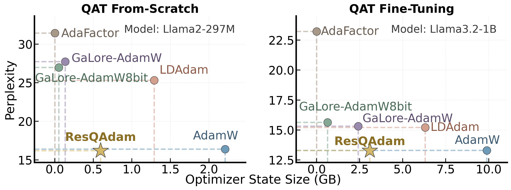

# ResQAdam: Residual-Preserving Adaptive Optimization for Memory-Efficient Quantization-Aware Training

This repository contains a reference torch implementation of the ResQAdam optimizer and the code for reproducing the experiments in the paper: [ResQAdam: Residual-Preserving Adaptive Optimization for Memory-Efficient Quantization-Aware Training]()

**Abstract**: Quantization-aware training (QAT) is the most reliable way to obtain accurate low-bit large language models (LLMs), but training with AdamW keeps two dense FP32 states for every weight matrix. We find that low-rank memory-efficient optimizers such as GaLore and LDAdam degrade substantially in QAT. A considerable part of the QAT momentum lies outside its top-r singular subspace, and projection-based methods discard this part at every step. We further observe that this residual remains useful when only its sign is kept. Based on these observations, we propose ResQAdam. It keeps a single BF16 momentum, applies Adam only to the $r\times r$ coordinates of the principal subspace, and adds a normalized sign update computed from the residual. We evaluate ResQAdam with two from-scratch QAT methods and three QAT fine-tuning pipelines, with weights quantized down to 2 bits. It reduces optimizer-state memory by 71% to 74% relative to AdamW, stays close to AdamW in most settings, and lowers training throughput by less than 2%.


<p align="center"></p>

## Environment

The code is tested with Python 3.10, CUDA 12.8 and PyTorch 2.9.0.

```bash
conda create -n resqadam python=3.10 -y
conda activate resqadam

# PyTorch (pick the wheel that matches your CUDA version)
pip install torch==2.9.0 --index-url https://download.pytorch.org/whl/cu128

# Other dependencies, including the baseline optimizers (GaLore, LDAdam, bitsandbytes)
pip install -r requirements.txt

# FlashAttention-2 (used in the paper; optional, otherwise pass --attn_implementation sdpa)
pip install flash-attn==2.8.3 --no-build-isolation
```

Llama models on Hugging Face are gated, so run `huggingface-cli login` before training.

## Usage

```python
from resqadam import build_resqadam

# (weight, weight_quantizer) pairs of all quantized linear layers
pairs = [(m.weight, m.w_quantizer) for m in model.modules() if isinstance(m, QLinear)]
optimizer = build_resqadam(
    model, pairs, lr=8e-5, weight_decay=0.1, rank=64, adapt_interval=200,
    total_steps=num_steps, refresh_warmup_ratio=0.0,  # 0.1 for from-scratch QAT
)
```

Quantized weights are updated by ResQAdam, and all other parameters use AdamW.
We use `rank=64, adapt_interval=200` for QAT fine-tuning and `rank=32, adapt_interval=400, refresh_warmup_ratio=0.1` for from-scratch QAT.

## Reproducing Basic QAT

### Data format

We do not release the training data. `train.py` reads a directory of pre-tokenized chunks `0.npy, 1.npy, ...`, each an `int32` array of shape `(num_samples, context_len)`; `--num_files` sets how many chunks are used. Each row is one training sequence (input `row[:-1]`, labels `row[1:]`), and rows are read in order, so shuffle them beforehand.
In the paper, the data is SlimPajama tokenized with the model's tokenizer, documents are concatenated with EOS, and each chunk holds 256M tokens:

| Setting | Tokenizer | `context_len` | Chunks |
|---|---|---|---|
| Fine-tuning (Llama 3.2-1B) | model's own | 4096 | 8 (2B tokens) |
| From scratch (297M) | Llama 2 | 2048 | 24 (6B tokens) |

[`examples/data/`](examples/data) contains a tiny sample in this format (2 chunks of shape `(8, 2048)` with synthetic Llama 2 token ids) for checking the pipeline:

```bash
python train.py --mode scratch --model_name Llama2-297M \
    --model_config configs/model/Llama2-297M.json --tokenizer meta-llama/Llama-2-7b-hf \
    --quant_config configs/quant/Llama2-297M.json \
    --data_dir examples/data --num_files 2 --output_dir outputs/sample \
    --w_bits 2 --a_bits 16 --qat_optim resqadam --lr 3e-3 --rank 32 --svd_step 400 \
    --per_device_train_batch_size 2 --gradient_accumulation_steps 1
```

### Training and evaluation

```bash
# QAT fine-tuning of Llama 3.2-1B (8 GPUs)
DATA_DIR=/path/to/chunks OPTIM=resqadam W_BITS=2 A_BITS=16 LR=8e-5 bash scripts/finetune.sh
DATA_DIR=/path/to/chunks OPTIM=resqadam W_BITS=4 A_BITS=4  LR=3e-5 bash scripts/finetune.sh

# From-scratch QAT of a 297M Llama-style model (8 GPUs)
DATA_DIR=/path/to/chunks OPTIM=resqadam W_BITS=2 A_BITS=16 LR=3e-3 bash scripts/scratch.sh
```

`OPTIM` selects the optimizer: `resqadam`, or one of the baselines `adamw`, `galore-adamw`, `galore-adamw-8bit`, `ldadam`, `adafactor` (defined in [`baselines.py`](baselines.py); projection-based baselines use rank 64, e.g. `RANK=64` for `scripts/scratch.sh`).
Other models are supported by passing the matching file in `configs/quant/` (Llama 2-7B, Qwen2.5-1.5B, Qwen3 4B-Base).
`eval.py` reports WikiText-2 / C4 perplexity and zero-shot accuracy via `lm-eval`.

## Combining with Other QAT Methods

To reproduce the results of ResQAdam combined with other QAT baselines ([LLM-QAT](https://github.com/facebookresearch/LLM-QAT), [EfficientQAT](https://github.com/OpenGVLab/EfficientQAT), [QuEST](https://github.com/IST-DASLab/QuEST), [CAGE](https://github.com/IST-DASLab/CAGE)), simply replace the optimizer with ResQAdam when training with the corresponding method, as shown in [Usage](#usage); everything else in the training pipeline stays unchanged.
All baselines we tested use their official open-source implementations.

## Main Results

All values are AdamW / ResQAdam. Optimizer-state size excludes the embedding and LM head.

**From-scratch QAT** (average of WikiText-2 and C4 perplexity; see [Combining with Other QAT Methods](#combining-with-other-qat-methods) for QuEST / CAGE)

| Model | Method | W2A2 | W2A16 | W4A4 | Opt. State |
|---|---|---|---|---|---|
| 200M | QuEST | 38.78 / 39.20 | 33.48 / 33.11 | 31.46 / 32.20 | 1.63 / **0.44** GB (↓73.0%) |
| 200M | CAGE  | 39.17 / 39.99 | 33.99 / 34.09 | 31.71 / 32.66 | |
| 430M | QuEST | 30.40 / 31.80 | 26.77 / 26.92 | 26.08 / 26.26 | 3.54 / **0.94** GB (↓73.4%) |
| 430M | CAGE  | 31.15 / 31.75 | 27.50 / 27.36 | 26.43 / 26.35 | |

**QAT fine-tuning** (average zero-shot accuracy ↑ / average perplexity ↓)

| Model | Method | Q-Cfg | Avg. Acc. | Avg. PPL | Opt. State |
|---|---|---|---|---|---|
| Llama 3.2-1B | Basic QAT | W2A16G128 | 47.56 / 47.36 | 16.92 / 17.73 | 7.78 / **2.16** GB |
| | Basic QAT | W4A4G128 | 51.29 / 51.29 | 15.12 / 14.91 | |
| | LLM-QAT | W4A16C | 51.16 / 52.00 | 14.03 / 14.30 | 7.78 / **2.16** GB |
| | EfficientQAT | W3A16G128 | 49.93 / 49.31 | 16.73 / 16.79 | 494 / **141** MB/block |
| | EfficientQAT | W4A16G128 | 54.43 / 54.56 | 12.78 / 12.81 | |
| Qwen3 4B-Base | Basic QAT | W2A16G128 | 61.29 / 61.94 | 12.76 / 12.88 | 29.07 / **7.78** GB |
| | Basic QAT | W4A4G128 | 68.21 / 67.91 | 12.27 / 12.20 | |
| | LLM-QAT | W4A16C | 68.07 / 66.81 | 11.68 / 11.93 | 29.07 / **7.78** GB |
| | EfficientQAT | W4A16G128 | 69.29 / 69.49 | 10.88 / 10.94 | 820 / **220** MB/block |
| Llama 2-7B | LLM-QAT | W4A16C | 63.11 / 61.68 | 6.82 / 6.89 | 51.81 / **13.28** GB |
| | EfficientQAT | W4A16G128 | 63.77 / 63.76 | 6.49 / 6.49 | 1644 / **451** MB/block |

See the paper for the full table, including W2 and W4A4 LLM-QAT / EfficientQAT settings.

**Comparison with memory-efficient optimizers** (average perplexity, rank 64, learning rate tuned per optimizer)

| Paradigm | Q-Cfg | ResQAdam | GaLore-AdamW | GaLore-AdamW8bit | LDAdam | AdaFactor |
|---|---|---|---|---|---|---|
| From-scratch | W2A16G128 | **20.05** | 30.61 | 30.39 | 28.57 | 33.01 |
| From-scratch | W4A4G128 | **18.89** | 32.93 | 32.45 | 28.23 | 32.84 |
| Fine-tuning | W2A16G128 | **16.89** | 19.25 | 20.32 | 19.59 | 27.79 |
| Fine-tuning | W4A4G128 | 15.05 | 15.30 | 15.64 | 15.42 | **14.80** |

**Efficiency** (Basic QAT, W4A4G128, context 4096, single H200, $r=64$)

| AdamW / ResQAdam | Llama 3.2-1B | Qwen2.5-1.5B | Qwen3 4B-Base |
|---|---|---|---|
| Opt. state (GB) | 7.78 / 2.16 (↓72.2%) | 10.48 / 3.01 (↓71.3%) | 29.07 / 7.78 (↓73.2%) |
| Peak memory (GB) | 33.33 / 28.24 (↓15.3%) | 43.93 / 37.19 (↓15.3%) | 99.14 / 79.77 (↓19.5%) |
| Throughput (tok/s) | 29.36k / 28.94k (↓1.4%) | 18.31k / 18.19k (↓0.6%) | 9.64k / 9.56k (↓0.8%) |

## Repository Structure

```
resqadam.py          # ResQAdam optimizer
baselines.py         # baseline optimizers (AdamW, GaLore, LDAdam, AdaFactor)
train.py             # Basic QAT (fine-tuning / from scratch) with ResQAdam or a baseline
eval.py              # perplexity and zero-shot evaluation
quant/quant_linear.py  # fake-quantized linear layer (LSQ weights, MinMax activations)
models/              # Llama / Qwen2 / Qwen3 with quantized linear layers
data_utils/          # training / evaluation data loading
examples/data/       # tiny data sample in the training format
configs/             # model, quantization and accelerate configs
scripts/             # launch scripts
```

## Acknowledgements

The model definitions are adapted from [Hugging Face Transformers](https://github.com/huggingface/transformers). Baselines use the official [GaLore](https://github.com/jiaweizzhao/GaLore) and [LDAdam](https://github.com/IST-DASLab/LDAdam) implementations.
